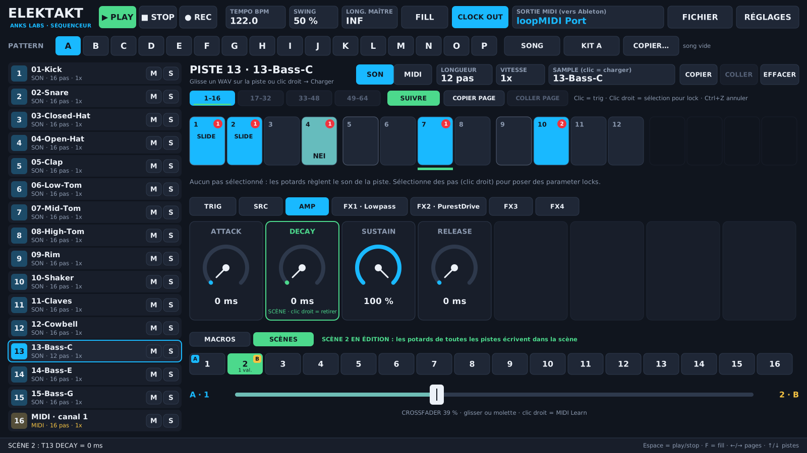

<div align="center">

# ELEKTAKT
### ELEKTRON-STYLE SEQUENCER · SOUND + MIDI TRACKS · FREE


**ANKS LABS // BUILD. BREAK. REWIRE. LISTEN.**

[](../../releases/latest)
[](../../releases)

</div>


> **FR —** ELEKTAKT est un séquenceur autonome pour Windows, inspiré de la façon de travailler des machines Elektron : des **parameter locks** par pas, des **trig conditions**, une **longueur et une vitesse par piste**, du micro-timing et des retrigs. Chaque piste joue soit un **sample** (avec 4 effets Airwindows), soit des **notes MIDI** envoyées vers Ableton ou un autre logiciel. Il reprend le moteur audio du projet KICK d'ANKS Labs.
>
> **EN —** ELEKTAKT is a standalone Windows sequencer inspired by the Elektron workflow: per-step **parameter locks**, **trig conditions**, **per-track length and speed**, micro-timing and retrigs. Each track plays either a **sample** (with four Airwindows effects) or **MIDI notes** sent to Ableton or any other software. It reuses the audio engine of the ANKS Labs KICK project.

## 01 // TÉLÉCHARGER ET LANCER — DOWNLOAD & RUN

1. Ouvre **[la dernière version](../../releases/latest)** et télécharge `ELEKTAKT-Windows-x64-0.2.0.zip` (le numéro est dans le nom : prends toujours le plus grand).
2. Clic droit sur le ZIP → **Extraire tout**. Garde le dossier `demo-kit` à côté de `ELEKTAKT.exe`.
3. Lance **ELEKTAKT.exe**. Aucune installation. Un pattern de démonstration est chargé : appuie sur **Espace**.



*Windows peut afficher « Windows a protégé votre ordinateur » : clique sur **Informations complémentaires → Exécuter quand même** (le programme n'est pas signé, c'est normal pour un projet gratuit).*

**EN —** Download the latest ZIP from Releases, extract everything, keep `demo-kit` next to `ELEKTAKT.exe` and run it. No installation.

## 02 // LE SÉQUENCEUR — THE SEQUENCER

| Fonction | Comment faire |
|:--|:--|
| **Trig** | Clic sur un pas. Glisser la souris peint plusieurs pas. |
| **Parameter lock** | **Clic droit** sur un ou plusieurs pas (ils s'entourent de blanc), puis tourne un potard : la valeur ne s'applique qu'à ces pas. Le potard devient rouge, le pas reçoit un point rouge. Clic droit sur le potard = retirer le lock. |
| **Trigless lock** | Même geste sur un pas **vide** : il change le son en cours (filtre, effets, pan, CC MIDI…) sans rejouer de note. Cadre rouge. |
| **Trig conditions** | Page **TRIG**, potard **CONDITION** : `1:2`… `8:8` (joue au passage A sur B), `FILL` / `!FILL` (bouton FILL ou touche F maintenue), `PRE` / `!PRE` (selon le dernier trig conditionnel de la piste), `NEI` / `!NEI` (selon la piste au-dessus), `1ST` / `!1ST` (premier passage). |
| **Probabilité** | Page TRIG, 0 à 100 % par pas. |
| **Micro-timing** | Page TRIG, −23 à +23 vingt-quatrièmes de pas (en avance / en retard). |
| **Retrig** | Page TRIG, 1 à 8 coups dans le pas. |
| **Parameter slide** | Page TRIG, potard **SLIDE** sur un pas sélectionné : ses valeurs verrouillées glissent en douceur jusqu'au prochain lock du même paramètre (volume, pan, enveloppe, effets, CC MIDI). Le pas affiche « SLIDE ». |
| **Scènes + crossfader** | En bas, onglet **SCÈNES** : 16 scènes par pattern. Clic sur une scène = édition : les potards de **toutes les pistes** écrivent dans la scène (potard vert). Clic droit = la mettre en **A** ou en **B**. Le **crossfader** passe en douceur de A à B, à la souris, à la molette ou avec un potard MIDI (clic droit = MIDI Learn). |
| **Copier / coller** | Pas sélectionnés : **COPIER LES PAS** puis sélectionne le pas de départ et **COLLER ICI** (ou Ctrl+C / Ctrl+V). **COPIER PAGE / COLLER PAGE** pour 16 pas d'un coup. Sans sélection, Ctrl+C / Ctrl+V copie la piste entière. |
| **Annuler** | **Ctrl+Z** annule, **Ctrl+Y** rétablit (64 niveaux) : pas, locks, réglages de piste, scènes. Les réglages de son (sample, effets choisis) ne sont pas concernés. |
| **Longueur / vitesse par piste** | En haut : **LONGUEUR** (1 à 64 pas, molette ou glisser, clic droit = valeurs rapides) et **VITESSE** (2x, 1x, 1/2x, 1/4x, 1/8x). Des pistes de longueurs différentes créent des polyrythmies. |
| **Longueur maître** | `INF` : les pistes tournent librement et un pattern en attente démarre toutes les 16 pas. Une valeur (1–64) relance toutes les pistes à ce rythme. |
| **Swing** | 50 à 80 %, appliqué aux pas pairs. |
| **Patterns A–P** | 16 patterns. Pendant la lecture, le pattern choisi démarre à la fin du cycle. Clic droit : copier, coller, effacer. |
| **Song** | Bouton SONG : enchaîne des patterns (×1, ×2, ×4), puis « Jouer le song ». |
| **Macros M1–M8** | Touche un potard, puis clic droit sur une macro → Assigner. **MIDI Learn** pour la piloter avec un LPD8, un MPK mini… |
| **REC** | Arme REC, lance la lecture et joue sur ton clavier MIDI : les notes s'écrivent sur la piste sélectionnée. |

**Pistes SON** : pages **SRC** (hauteur, début, fin, volume, pan), **AMP** (enveloppe ADSR) et **FX1–FX4** (31 effets Airwindows : filtres, saturations, compresseurs, delays, réverbes, lo-fi…). Tout est verrouillable par pas.
Charge un son par **glisser-déposer** d'un WAV sur la piste, ou clic droit → *Charger un sample*.

**Pistes MIDI** : page **TRIG** (note, vélocité, longueur) et page **CC MIDI** (8 contrôleurs, numéro réglable à la molette sur le titre). Les notes, les CC verrouillés et l'horloge partent vers la sortie MIDI choisie.

## 03 // RELIER À ABLETON — CONNECT TO ABLETON

1. Installe **[loopMIDI](https://www.tobias-erichsen.de/software/loopmidi.html)** (gratuit) et crée un port avec le bouton **+**.
2. Dans ELEKTAKT, clique sur **SORTIE MIDI** et choisis le port loopMIDI. Passe une piste en **MIDI** (bouton SON | MIDI) et choisis son canal (clic droit sur la piste).
3. Dans Ableton : **Préférences → Link, Tempo & MIDI**, ligne d'entrée loopMIDI : **Piste = On** (notes) et **Sync = On** (horloge). Dans Live, clique sur **EXT** à côté du tempo pour suivre ELEKTAKT.
4. Sur une piste MIDI d'Ableton : entrée = loopMIDI, canal = celui de la piste ELEKTAKT, **Monitor = In**.

Le bouton **CLOCK OUT** coupe ou rétablit l'envoi de l'horloge. Les notes MIDI sont envoyées au moment où le son d'ELEKTAKT sort des haut-parleurs, pour rester calées.

## 04 // RACCOURCIS — SHORTCUTS

`Espace` lecture / stop · `F` maintenu = FILL · `Échap` relâcher la sélection · `Suppr` effacer les locks sélectionnés · `←` `→` pages de pas · `↑` `↓` pistes · `F1`–`F8` pages de potards · `R` REC · `Ctrl+S` enregistrer · `Ctrl+O` ouvrir · `Ctrl+N` nouveau · `Ctrl+C` / `Ctrl+V` copier / coller (pas sélectionnés ou piste) · `Ctrl+Z` / `Ctrl+Y` annuler / rétablir · `Maj` + potard = réglage fin.

## 05 // FICHIERS — FILES

| Fichier | Contenu |
|:--|:--|
| `.elektakt` | Projet complet : patterns, pistes, locks, song, kits. |
| `.kicklab` | Projet KICK : **FICHIER → Importer un projet KICK** convertit ses pas en trigs. |
| `.kickkit` | Kit de 16 sons et leurs réglages (compatible KICK). |
| `.wav` | **FICHIER → Exporter le pattern en WAV** : un cycle complet, 48 kHz / 24 bits. |

L'historique des versions est dans [CHANGELOG.md](CHANGELOG.md). Les réglages des macros, du crossfader et des appareils MIDI sont gardés à côté de `ELEKTAKT.exe` (`ELEKTAKT-settings.txt`, `ELEKTAKT-devices.txt`).

## 06 // FEUILLE DE ROUTE — ROADMAP

- [x] Séquenceur 16 pistes × 64 pas, longueur et vitesse par piste
- [x] Parameter locks, trigless locks, trig conditions, probabilité, micro-timing, retrig
- [x] Pistes son (samples + 4 effets) et pistes MIDI, horloge MIDI
- [x] Macros M1–M8 avec MIDI Learn, import des projets KICK
- [x] Scènes avec crossfader A/B, parameter slide (0.2.0)
- [x] Copier / coller de pas et de pages, annuler / rétablir (0.2.0)
- [ ] Version VST3 pour Ableton

## 07 // COMPILER — BUILD FROM SOURCE

Windows, Visual Studio 2022 + CMake :

```powershell
cmake -S . -B build -A x64
cmake --build build --config Release
ctest --test-dir build -C Release --output-on-failure
```

Linux (tests du moteur et rendu de l'interface en PNG) : `cmake -S . -B build -DTRIG_UI_HARNESS=ON && cmake --build build && ./build/TRIG-Test`.
Compilation croisée MinGW : `-DCMAKE_TOOLCHAIN_FILE=tools/mingw.cmake`.

## 08 // LICENCE & SOURCES

ELEKTAKT est libre et gratuit, sous **AGPL-3.0-or-later**. Il est construit sur le moteur **KICK** d'ANKS Labs, basé sur le code ouvert **AudIO / KICK de Music Tribe** ([0700-AAM](https://github.com/MusicTribeOpenSource/0700-AAM), AGPL-3.0), avec les effets **[Airwindows](https://www.airwindows.com/)** de Chris Johnson (MIT) et **AudioFile** d'Adam Stark (MIT). Détails : [NOTICES.txt](NOTICES.txt).

L'ergonomie s'inspire des machines **Elektron**. Elektron, Ableton, Behringer, Music Tribe et KICK sont des marques de leurs propriétaires ; ANKS Labs n'est ni affilié à ces fabricants ni approuvé par eux.

---

<div align="center">

**ANKS LABS // EXPERIMENTAL AUDIO DEVELOPMENT**

</div>
